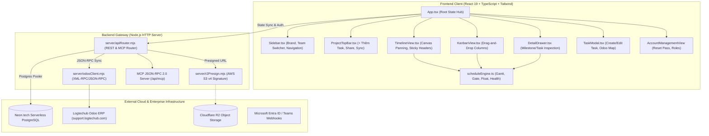

# TIANLANE PROJECT GOVERNANCE & DELIVERY PLATFORM
## Master Specification & Comprehensive Architectural Blueprint (`tianlane-spec.md`)

> **Spec-Kit & CodeGraph Alignment Statement**:
> This document is the executable single source of truth for the **Tianlane Platform**. It adheres strictly to GitHub **Spec-Kit** Specification-Driven Development (SDD) standards and reflects the ground-truth symbol topology verified by **CodeGraph** (`.codegraph/codegraph.db`). Future AI coding agents and human engineers must inspect, analyze, and converge any code changes against this specification.

---

## 1. System Constitution & Non-Negotiables

The principles below represent hard non-negotiable architectural boundaries. No feature addition, performance optimization, or UI adjustment may violate or bypass these rules.

1. **Three-Tier Governance Hierarchy (`Project > Milestone > Task`)**:
   - A `Project` represents a strategic initiative linked to an Odoo project (`project.project`).
   - A `Milestone` represents a time-boxed delivery phase with mandatory Phase-Gate criteria (required deliverables + blockers check).
   - A `Task` represents an actionable work unit linked directly to an execution tracker ticket (`project.task`). Tasks never exist in isolation without a parent Milestone.
2. **Execution Single Source of Truth**:
   - Tianlane governs **Milestones, Governance Baselines, Phase-Gate Sign-offs, and Project Access**.
   - Odoo ERP (`support.logtechub.com`) remains the **Single Source of Truth (SSOT) for granular timesheets, actual worklogs, and developer tickets**.
   - Tianlane synchronizes bidirectionally via JSON-RPC / MCP (`server/odooClient.mjs`).
3. **Discreet Security & Zero Credential Leaking**:
   - Authentication errors MUST NEVER leak password formulas, usernames, or directory hints.
   - All cloud storage uploads MUST use Cloudflare R2 presigned PUT URLs (`/api/storage/presign`). Zero client credentials or master S3 secret keys may be bundled in the browser.
4. **Resilient Multi-Tenant Hybrid Storage**:
   - Client state hydrates from Neon Serverless PostgreSQL (`workspace_state_store`) on startup.
   - Local mutations apply immediately (optimistic UI), cache into browser `localStorage`, and debounce-sync (350ms) to Neon PostgreSQL.
   - If offline, Tianlane functions fully as a PWA, deferring cloud sync until connectivity resumes.
5. **Role-Based Access Control (RBAC) Integrity**:
   - `Admin` (`james.nhan@logtechub.com`): Unrestricted across all Teams, Accounts, and Projects.
   - `Team PM`: Manages positions/roles within their assigned Team and can edit projects belonging to their team.
   - `Project Roles`: `Owner` (full edit, member management, project deletion), `Writer` (edit tasks, shift dates, upload deliverables), `Viewer` (read-only audit access).

```
                      TIANLANE THREE-TIER HIERARCHY
 ┌────────────────────────────────────────────────────────────────────────┐
 │ 1. PROJECT (e.g. 19-03 Control Tower / 26-11 eFMS Mobile)              │
 │    - Code, Name, Baseline Schedule, Members & RBAC (Owner/Writer/View) │
 │    - Linked Odoo Project # (project.project)                           │
 └───────────────────────────────────┬────────────────────────────────────┘
                                     │ 1 to N
                                     ▼
 ┌────────────────────────────────────────────────────────────────────────┐
 │ 2. MILESTONE (e.g. M01 Inception & Alignment / M02 Core Engine)        │
 │    - Planned Start / End vs Actual Start / End (Variance & Float)      │
 │    - Phase Gate Closure: Requires Mandatory Docs + Gate Blockers Cleared│
 └───────────────────────────────────┬────────────────────────────────────┘
                                     │ 1 to N
                                     ▼
 ┌────────────────────────────────────────────────────────────────────────┐
 │ 3. TASK (e.g. 19-03-T10 Architecture DFD & API Spec)                   │
 │    - Kanban Status: Todo -> In Progress -> Review -> Done              │
 │    - Gate Blocker Checkbox (Blocks Milestone Gate Closure)             │
 │    - Assignee (10 Logtechub Directory Users)                           │
 │    - Linked Odoo Task # & URL (support.logtechub.com)                  │
 └────────────────────────────────────────────────────────────────────────┘
```

---

## 2. User Scenarios & Prioritized User Journeys

### User Story 1 - Multi-User Authentication & Admin Password Reset (Priority: P1)
As a member of Logtechub, I want to authenticate cleanly using my company email (`@logtechub.com`) and default formula password (`<username>2026`), customize my profile/password, and have the Admin reset my password if forgotten, so that my account is always secure and accessible.

- **Why this priority**: Essential trust boundary; without secure identity, no RBAC or multi-user collaboration can function.
- **Independent Test**: Authenticate with `james.nhan@logtechub.com` and `james.nhan2026`. Change password via Profile Modal. Reset password via Admin Accounts view. Confirm previous custom password is wiped and default year formula works again.
- **Acceptance Scenarios**:
  1. **Given** a user inputs `james.nhan` and `james.nhan2026`, **When** clicking "Continue", **Then** the system logs them in as Product Owner & Admin without exposing formulas.
  2. **Given** an invalid password, **When** submitting, **Then** show `"Mật khẩu không chính xác. Vui lòng thử lại."` without leaking hints.
  3. **Given** an Admin in `/accounts` clicks "Reset Password" for `azura.thuy@logtechub.com`, **When** confirmed, **Then** backend executes `UPDATE users_directory SET custom_password = NULL WHERE email = 'azura.thuy@logtechub.com'` and alerts Admin with the restored formula.

---

### User Story 2 - Comprehensive Project > Milestone > Task Lifecycle (Priority: P1)
As a Project Manager or Tech Lead, I want to create, inspect, and update tasks nested under specific Milestones, assign team members, flag gate blockers, and link directly to Odoo tasks, so that our team maintains strict governance over project delivery.

- **Why this priority**: Core value proposition of Tianlane. Eliminates lost context between high-level milestones and low-level dev tickets.
- **Independent Test**: Create a task via Top Bar button `+ Thêm Task`. Fill Title, Milestone, Assignee, Odoo ID `204`, and Blocker toggle. Verify task displays in Timeline swimlane, Kanban board, Milestone Detail Drawer, and can be edited via `TaskModal`.
- **Acceptance Scenarios**:
  1. **Given** any project view, **When** clicking `+ Thêm Task` in the Top Bar, **Then** `TaskModal` opens with auto-generated code (e.g. `19-03-T11`).
  2. **Given** a Milestone swimlane in `TimelineView`, **When** clicking `+ Task` on the milestone header, **Then** `TaskModal` opens with that milestone pre-selected.
  3. **Given** a Milestone in `DetailDrawer`, **When** expanding "Danh sách Tasks", **Then** see all tasks under that milestone, their status, and click to edit or create a new child task.
  4. **Given** a Task with `is_gate_blocker = true` in `todo` status, **When** attempting to close the parent Milestone gate, **Then** the action is blocked with `"Task [Code] is marked as a gate blocker and is not completed."`

---

### User Story 3 - Multi-Team Directory & Access Control (Priority: P2)
As a user belonging to specific business teams (e.g. Control Tower Team vs eFMS Team), I want a team switcher above the Inbox and isolated views, so that members only access projects appropriate to their team, while Admins have global visibility.

- **Why this priority**: Enterprise confidentiality across logistics and software divisions.
- **Independent Test**: Sign in as `kenny.thuong@logtechub.com` (Control Tower Team). Verify team switcher only lists accessible teams. Sign in as `james.nhan@logtechub.com` (Admin). Verify ability to view all teams and create new teams.
- **Acceptance Scenarios**:
  1. **Given** non-admin user `daley.thai`, **When** opening team dropdown, **Then** only teams containing their `user_id` are shown.
  2. **Given** Admin `james.nhan`, **When** opening team dropdown, **Then** all company teams plus `+ Tạo Team mới` button are available.
  3. **Given** a Team PM in `TeamView`, **When** modifying a member's Position (e.g. Senior Dev -> Tech Lead), **Then** position updates locally and persists to `/api/users/profile`.

---

### User Story 4 - Interactive Visual Timeline with Sticky Clamping & Anchors (Priority: P2)
As a stakeholder reviewing project schedules, I want a wide 273-day horizontal timeline with swimlanes, milestone health indicators, sticky headers that never scroll out of view, and off-screen jump anchors, so that I can audit delivery progress at any zoom level.

- **Why this priority**: High-level executive visibility and sprint alignment.
- **Independent Test**: Pan horizontally across August 2026 to April 2027. Verify off-screen milestones show floating pill anchors with jump arrows; verify sticky headers remain legible inside visible container borders.
- **Acceptance Scenarios**:
  1. **Given** a milestone container scrolled partially out of view, **Then** its title bar clamps horizontally using `stickyHeaderOffsetPx`.
  2. **Given** a milestone located to the right of current scroll viewport, **Then** an off-screen right anchor card appears with `ArrowRight` jump button.

---

### User Story 5 - Live Odoo ERP Bidirectional Synchronization & MCP Server (Priority: P2)
As an automated agent or PO, I want to dispatch unlinked tasks to Odoo and sync live hours/stages back to Tianlane via Streamable HTTP Model Context Protocol (MCP) JSON-RPC 2.0.

- **Why this priority**: Eliminates dual entry between PM governance and JIRA/Odoo developer workflows.
- **Independent Test**: Execute `POST /api/mcp` with `tools/call` for `sync_tasks_status_with_odoo` and verify Odoo stages map into Tianlane Kanban status.

---

## 3. Comprehensive Functional Requirements (FR)

### Subsystem 1: Identity, Directory & Authentication
- **FR-001**: System MUST maintain 10 official `@logtechub.com` seeded accounts with standard initial positions:
  - `james.nhan@logtechub.com` (Product Owner, Admin: true)
  - `azura.thuy@logtechub.com` (Product Owner)
  - `kenny.thuong@logtechub.com` (Tech Lead)
  - `brian.binh@logtechub.com` (Senior Dev)
  - `daley.thai@logtechub.com` (Senior Dev)
  - `lynne.loc@logtechub.com` (UI/UX Designer)
  - `jasmine.thu@logtechub.com` (QA Engineer)
  - `edwin.tai@logtechub.com` (Senior Dev)
  - `anatolius.thuan@logtechub.com` (Senior Dev)
  - `alex.phuong@logtechub.com` (QA Engineer)
- **FR-002**: Password verification MUST accept: (1) Custom password stored in `users_directory.custom_password`, OR (2) Default formula `<username>${currentYear}` (e.g. `james.nhan2026`).
- **FR-003**: System MUST NOT display password formula hints in any modal, error banner, or login card.
- **FR-004**: Users MUST be able to update their display name, avatar URL, avatar initials, and custom password in `UserProfileModal`.
- **FR-005**: Admin MUST have an `AccountManagementView` at `/accounts` enabling:
  - Full company directory inspection.
  - Position/Role reassignment for any account.
  - One-click **Reset Password**, which sets `custom_password = NULL` in Neon PostgreSQL and restores default `<username>${currentYear}` login.

### Subsystem 2: Project & Governance Management
- **FR-006**: System MUST support instantiating projects from standard templates (`instantiateProjectFromTemplateEngine`) with calculated relative date offsets.
- **FR-007**: Every project MUST contain: `code`, `name`, `client_or_unit`, `odoo_project_id`, `odoo_project_url`, `start_date`, `baseline_committed`, and `share_token`.
- **FR-008**: System MUST support Baseline Commit (`handleCommitBaseline`): freezes current schedule into `planned_start` and `planned_end`. Any subsequent date changes generate a `BaselineRevisionEntry` log.
- **FR-009**: Project membership MUST enforce 3 distinct roles: `owner`, `writer`, `viewer`.
  - Only `owner` can delete project or alter project-level metadata.
  - `writer` can create/edit milestones and tasks.
  - `viewer` has read-only access (all mutation buttons disabled).

### Subsystem 3: Milestones & Phase-Gate Governance
- **FR-010**: Milestones MUST track `planned_start`, `planned_end`, `actual_start`, `actual_end`, `is_ongoing_phase`, and `review_cycle_date`.
- **FR-011**: Milestone progress percentage MUST dynamically calculate from child tasks: `progress_pct = round((completed_tasks / total_tasks) * 100)`.
- **FR-012**: Milestone Gate Closure (`canCloseMilestoneGate`) MUST evaluate:
  1. All mandatory deliverable documents for this milestone are uploaded (`doc_type` match).
  2. All child tasks flagged with `is_gate_blocker = true` must have `is_completed = true` (`kanban_status === 'done'`).
  3. Gate closure MUST be rejected with explicit blocker reasons if any check fails.

### Subsystem 4: Tasks & Execution Integration
- **FR-013**: Every task MUST belong to exactly one parent Milestone in the active Project.
- **FR-014**: Task Code MUST auto-sequence following `${project.code}-T${index}` (e.g. `19-03-T10`).
- **FR-015**: Task status MUST support 5 Kanban states: `backlog`, `todo`, `in_progress`, `review`, `done`.
- **FR-016**: Tasks MUST support linking to Odoo ERP tickets via `odoo_task_id` (integer) and `odoo_task_url`.
- **FR-017**: Tasks MUST support sub-item checklists with completion toggles and delete capabilities.
- **FR-018**: System MUST provide a dedicated modal (`TaskModal.tsx`) accessible from:
  - Project Top Bar (`+ Thêm Task`).
  - Milestone swimlane header in Timeline View (`+ Task`).
  - Empty Milestone swimlane call-to-action (`+ Thêm Task ngay`).
  - Detail Drawer Milestone task list (`+ Thêm Task vào Milestone`).
  - Clicking any task card in Timeline, Kanban, or Detail Drawer.

### Subsystem 5: Multi-Team Organization
- **FR-019**: System MUST support multiple teams (e.g. `Control Tower`, `eFMS`, `Mobile WMS`).
- **FR-020**: A team entity MUST define `id`, `code`, `name`, `icon`, `pm_ids[]`, and `member_ids[]`.
- **FR-021**: The Team Switcher placed above the Inbox MUST filter visible projects and members based on user access.

### Subsystem 6: Cloudflare R2 Presigned Deliverables
- **FR-022**: Deliverable uploads MUST be requested via `POST /api/storage/presign`.
- **FR-023**: Uploaded file size MUST NOT exceed 50 MB (52,428,800 bytes).
- **FR-024**: Uploaded documents MUST store `file_name`, `file_url`, `file_size_bytes`, `version_tag`, `doc_type`, and `uploaded_by`.

---

## 4. Non-Functional Requirements & Security Boundaries (NFR)

- **NFR-001 (Performance)**: Client bundle initial paint MUST render in under 800ms. Production build size MUST remain under 500 KB gzip (current: 115 KB gzip).
- **NFR-002 (Stateless Backend)**: The server (`server/apiRouter.mjs`) MUST NOT write state to local disk. State persists solely to Neon PostgreSQL and R2 object storage.
- **NFR-003 (Neon Scale-to-Zero)**: The database connection pool (`pg.Pool`) MUST set `max: 3` and `idleTimeoutMillis: 10000` to allow Neon serverless compute to scale down to zero when idle.
- **NFR-004 (Health Check Independence)**: The `/health` endpoint MUST NEVER query the database, ensuring zero cold-start delay during platform ping checks.
- **NFR-005 (PWA Resilience)**: All frontend assets MUST register via service worker (`public/sw.js`) and web app manifest (`public/manifest.json`), providing offline-first loading.
- **NFR-006 (Zero Credentials in Client)**: No database passwords, R2 secret access keys, or Odoo master credentials may be bundled in client JavaScript.

---

## 5. Edge Cases & Failure Modes

| Edge Case | Failure Scenario | System Handling & Mitigation |
|---|---|---|
| **Neon Cold Start / Timeout** | Database pool takes > 3s to wake from sleep. | Client optimistic state writes to `localStorage` immediately. Debounced sync catches up once DB wakes. |
| **Tampered Invite Token** | User modifies URL `?invite=fake-token`. | `App.tsx` detects `targetProj.share_token !== token`, rejects role grant, strips query string, and alerts user. |
| **Invalid Password Entry** | User enters wrong password. | Server & client respond with generic `"Mật khẩu không chính xác. Vui lòng thử lại."` Zero hints exposed. |
| **Milestone Gate Blocker Incomplete** | User attempts to close Milestone Gate with incomplete blocker tasks. | `canCloseMilestoneGate` returns `{ allowed: false, blockers: [...] }`. Close button disabled with list of unfinished blockers. |
| **Over-sized Document Upload** | User selects a file > 50 MB. | `validateAttachmentFileSize` rejects upload before initiating presign call, displaying error toast. |
| **Simultaneous PM Role Edits** | Multiple PMs update position concurrently. | Backend uses row-level atomic SQL `UPDATE users_directory SET role = $1 WHERE email = $2`. |

---

## 6. Technical Architecture & CodeGraph Dependency Topology

### High-Level Architecture Diagram



### CodeGraph Verified Blast Radius & Symbol Map

| Module / Symbol | File Location | Inward Callers (Blast Radius) | Responsibilities & Test Coverage |
|---|---|---|---|
| `App` | `src/App.tsx` | Root component rendered in `src/main.tsx` | Owns multi-project, milestone, task, team, and auth state. Handles local persistence and cloud synchronization. |
| `TaskModal` | `src/components/TaskModal.tsx` | Called by `App.tsx` (opens from TopBar, Timeline, Drawer) | Creates and edits tasks; maps Odoo Task ID and URL; toggles gate blockers; manages checklists. |
| `DetailDrawer` | `src/components/DetailDrawer.tsx` | Called by `App.tsx` | Inspects selected task or milestone. Renders phase gate criteria, deliverables upload, and child task list. |
| `TimelineView` | `src/components/TimelineView.tsx` | Called by `App.tsx` | Multi-month virtual canvas; renders swimlanes, sticky headers, date shifting, and offscreen jump anchors. |
| `AccountManagementView` | `src/components/WorkspaceViews.tsx` | Called by `App.tsx` | Admin control panel for 10 Logtechub accounts, role reassignment, and password reset. |
| `calculateMilestoneProgress` | `src/engine/scheduleEngine.ts` | Called by `App.tsx`, `scheduleEngine.ts` | Calculates milestone completion percentage based on child task completion. Tested in `scheduleEngine.test.ts`. |
| `canCloseMilestoneGate` | `src/engine/scheduleEngine.ts` | Called by `DetailDrawer.tsx` | Evaluates deliverable documents and blocker tasks before allowing milestone gate close. Tested. |
| `instantiateProjectFromTemplateEngine` | `src/engine/scheduleEngine.ts` | Called by `App.tsx` | Generates standard project milestones and tasks with relative day offsets. Tested. |
| `authenticateLogtechubUser` | `src/data/seedData.ts` | Called by `TeamsAuthModal.tsx` | Validates credentials against directory; supports custom passwords and default year formula. Tested. |
| `handleApiRequest` | `server/apiRouter.mjs` | Called by `server/index.mjs` | Routes `/api/auth/teams`, `/api/users/profile`, `/api/workspace`, `/api/odoo/*`, `/api/mcp`, `/api/storage/presign`. |
| `syncOdooTasks` | `server/odooClient.mjs` | Called by `server/apiRouter.mjs` | Bidirectional synchronization between Tianlane tasks and Odoo `project.task`. Tested. |
| `createR2PresignedPutUrl` | `server/r2Presign.mjs` | Called by `server/apiRouter.mjs` | Generates zero-disk AWS S3 v4 signed upload URLs for Cloudflare R2. Tested. |

---

## 7. Data Models & Database Schemas

### PostgreSQL DDL (`server/schema.sql`)

```sql
CREATE EXTENSION IF NOT EXISTS "pgcrypto";

-- 1. Directory Users
CREATE TABLE IF NOT EXISTS users_directory (
  id VARCHAR(64) PRIMARY KEY,
  microsoft_entra_id VARCHAR(128) UNIQUE NOT NULL,
  full_name VARCHAR(120) NOT NULL,
  email VARCHAR(160) UNIQUE NOT NULL,
  avatar_initials VARCHAR(8) NOT NULL DEFAULT 'PO',
  avatar_url TEXT,
  role VARCHAR(64) NOT NULL DEFAULT 'Product Owner',
  teams_status VARCHAR(32) NOT NULL DEFAULT 'available',
  teams_webhook_url TEXT,
  custom_password TEXT,
  is_admin BOOLEAN NOT NULL DEFAULT FALSE,
  team_id VARCHAR(64),
  created_at TIMESTAMPTZ NOT NULL DEFAULT NOW()
);

-- 2. Projects
CREATE TABLE IF NOT EXISTS projects (
  id VARCHAR(64) PRIMARY KEY,
  code VARCHAR(32) NOT NULL,
  name VARCHAR(200) NOT NULL,
  client_or_unit VARCHAR(160) NOT NULL DEFAULT '',
  description TEXT NOT NULL DEFAULT '',
  template_id VARCHAR(64),
  team_id VARCHAR(64),
  status VARCHAR(32) NOT NULL DEFAULT 'on_track',
  owner_id VARCHAR(64) REFERENCES users_directory(id) ON DELETE SET NULL,
  odoo_project_id INTEGER NOT NULL,
  odoo_project_url TEXT NOT NULL,
  start_date DATE NOT NULL,
  baseline_committed BOOLEAN NOT NULL DEFAULT FALSE,
  baseline_committed_at TIMESTAMPTZ,
  share_token VARCHAR(64) NOT NULL,
  invite_default_role VARCHAR(16) NOT NULL DEFAULT 'writer',
  members JSONB NOT NULL DEFAULT '[]'::jsonb,
  created_at TIMESTAMPTZ NOT NULL DEFAULT NOW()
);

-- 3. Project Milestones
CREATE TABLE IF NOT EXISTS project_milestones (
  id VARCHAR(64) PRIMARY KEY,
  project_id VARCHAR(64) NOT NULL REFERENCES projects(id) ON DELETE CASCADE,
  code VARCHAR(32) NOT NULL,
  title VARCHAR(200) NOT NULL,
  icon VARCHAR(16) NOT NULL DEFAULT '🎯',
  order_index INTEGER NOT NULL DEFAULT 0,
  planned_start DATE NOT NULL,
  planned_end DATE,
  actual_start DATE NOT NULL,
  actual_end DATE,
  review_cycle_date DATE,
  is_ongoing_phase BOOLEAN NOT NULL DEFAULT FALSE,
  progress_pct INTEGER NOT NULL DEFAULT 0,
  odoo_milestone_id INTEGER,
  is_closed BOOLEAN NOT NULL DEFAULT FALSE,
  created_at TIMESTAMPTZ NOT NULL DEFAULT NOW()
);

-- 4. Project Tasks
CREATE TABLE IF NOT EXISTS project_tasks (
  id VARCHAR(64) PRIMARY KEY,
  project_id VARCHAR(64) NOT NULL REFERENCES projects(id) ON DELETE CASCADE,
  milestone_id VARCHAR(64) NOT NULL REFERENCES project_milestones(id) ON DELETE CASCADE,
  code VARCHAR(32) NOT NULL,
  title VARCHAR(240) NOT NULL,
  description TEXT NOT NULL DEFAULT '',
  kanban_status VARCHAR(32) NOT NULL DEFAULT 'todo',
  priority VARCHAR(16) NOT NULL DEFAULT 'medium',
  is_completed BOOLEAN NOT NULL DEFAULT FALSE,
  is_gate_blocker BOOLEAN NOT NULL DEFAULT FALSE,
  assignee_id VARCHAR(64) REFERENCES users_directory(id) ON DELETE SET NULL,
  planned_start DATE NOT NULL,
  due_date DATE NOT NULL,
  actual_start DATE NOT NULL,
  actual_end DATE NOT NULL,
  float_days INTEGER NOT NULL DEFAULT 0,
  odoo_task_id INTEGER,
  odoo_task_url TEXT,
  odoo_stage_name VARCHAR(64),
  effective_hours NUMERIC(6, 2) NOT NULL DEFAULT 0.00,
  last_synced_at TIMESTAMPTZ,
  checklist JSONB NOT NULL DEFAULT '[]'::jsonb,
  created_at TIMESTAMPTZ NOT NULL DEFAULT NOW()
);

-- 5. Persistent Workspace State Store (Debounced JSONB sync)
CREATE TABLE IF NOT EXISTS workspace_state_store (
  id VARCHAR(32) PRIMARY KEY,
  state_json JSONB NOT NULL,
  updated_at TIMESTAMPTZ NOT NULL DEFAULT NOW()
);
```

---

## 8. API & MCP Protocols

### REST API Endpoints (`server/apiRouter.mjs`)

| Endpoint | Method | Payload / Params | Description |
|---|---|---|---|
| `/health` | `GET` | None | Instant health check. Returns `{ status: 'healthy', version: '2.0.0' }`. Zero DB queries. |
| `/api/auth/teams` | `POST` | `{ identifier, password }` | Authenticates Logtechub account. Returns `{ authenticated: true, user: UserProfile }`. Discreet error on mismatch. |
| `/api/users/profile` | `POST / PUT` | `{ email, fullName, role, newPassword, resetPassword, avatarUrl, isAdmin }` | Updates user profile. If `resetPassword: true`, sets `custom_password = NULL`. |
| `/api/workspace` | `GET` | None | Reads global workspace state JSON from Neon PostgreSQL. |
| `/api/workspace` | `PUT / POST` | `{ state: Object }` | Upserts workspace state into `workspace_state_store` table. |
| `/api/storage/presign` | `POST` | `{ fileName, contentType, fileSizeBytes, projectId }` | Validates ≤50MB cap and returns signed Cloudflare R2 upload URL. |
| `/api/odoo/test` | `POST` | `{ url, db, username, apiKey }` | Tests XML-RPC / JSON-RPC connection to Odoo server. |
| `/api/odoo/generate` | `POST` | `{ url, db, username, apiKey, odooProjectId, tasks[] }` | Batch-creates unlinked tasks into Odoo `project.task`. |
| `/api/odoo/sync` | `POST` | `{ url, db, username, apiKey, odooProjectId, tasks[], direction }` | Synchronizes stages and hours between Odoo and Tianlane. |

### Streamable Model Context Protocol (MCP) JSON-RPC 2.0 (`/api/mcp`)

- **Protocol**: JSON-RPC 2.0 over Streamable HTTP POST.
- **Server Info**: `name: "tianlane-po-governance-mcp"`, `version: "2.0.0"`.
- **Supported Tools**:
  1. `instantiate_project_from_template`: Creates standard governance project milestones and tasks from relative start date.
  2. `generate_odoo_tasks_from_app`: Batch-creates unlinked tasks in Odoo ERP with direct links.
  3. `sync_tasks_status_with_odoo`: Synchronizes stages, hours, and deadlines with Odoo.
  4. `get_project_roadmap_and_blockers`: Audits milestone schedule health, blockers, and float days.

---

## 9. Quality Verification & Convergence Checklist (`speckit-converge`)

Before declaring any feature complete or deploying a new release to production, the following verification pipeline MUST pass with zero failures:

```bash
# 1. Full automated unit & RBAC test suite
npm test
# Verified: 100% assertions pass (scheduleEngine, RBAC, Multi-Team, Discreet Auth, Password Reset).

# 2. Strict TypeScript type check
npx tsc --noEmit
# Verified: Exits with code 0.

# 3. Production Vite bundle build
npm run build
# Verified: 1611+ modules transformed, gzip size <= 120 KB.

# 4. Git tree verification
git status
# Verified: Clean working directory, pushed to origin main.
```

### Spec-Kit Convergence Matrix

- [x] **Constitution Check**: 3-tier hierarchy (`Project > Milestone > Task`) strictly maintained across all views.
- [x] **Authentication Check**: Discreet error messages enforced; zero formula leakage; custom password & reset password verified.
- [x] **Task Creation UX**: `+ Thêm Task` prominent on Project Top Bar, Milestone swimlane headers, and Milestone Drawer.
- [x] **Odoo Mapping**: Odoo Task ID and Direct URL supported in `TaskModal` and synchronized via MCP.
- [x] **Account Management**: Admin view `/accounts` operational with one-click password reset.
- [x] **Multi-Team Isolation**: Team Switcher above Inbox controls project and member access accurately.
- [x] **Deployment Continuity**: Cloudflare Workers & Render auto-deploy on `main` push.
